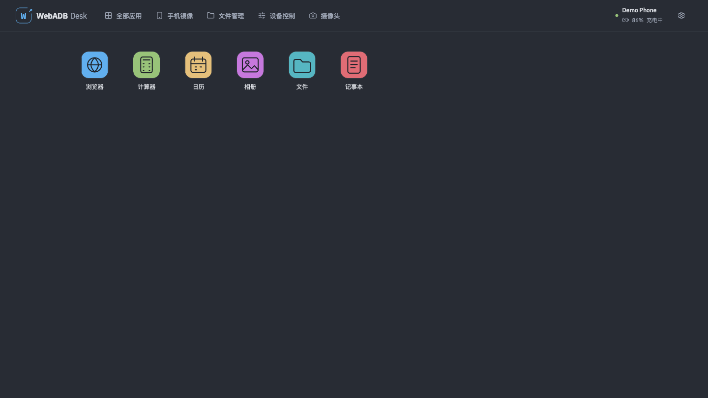
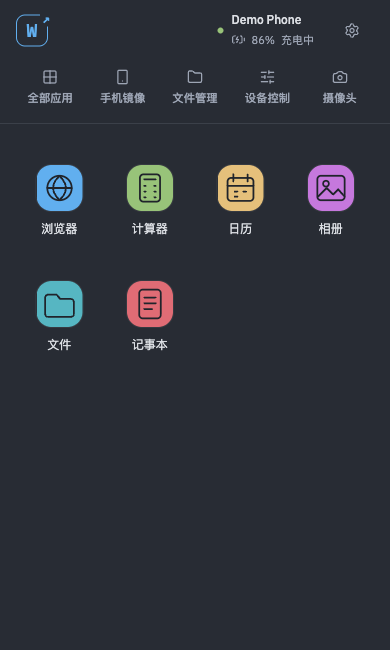
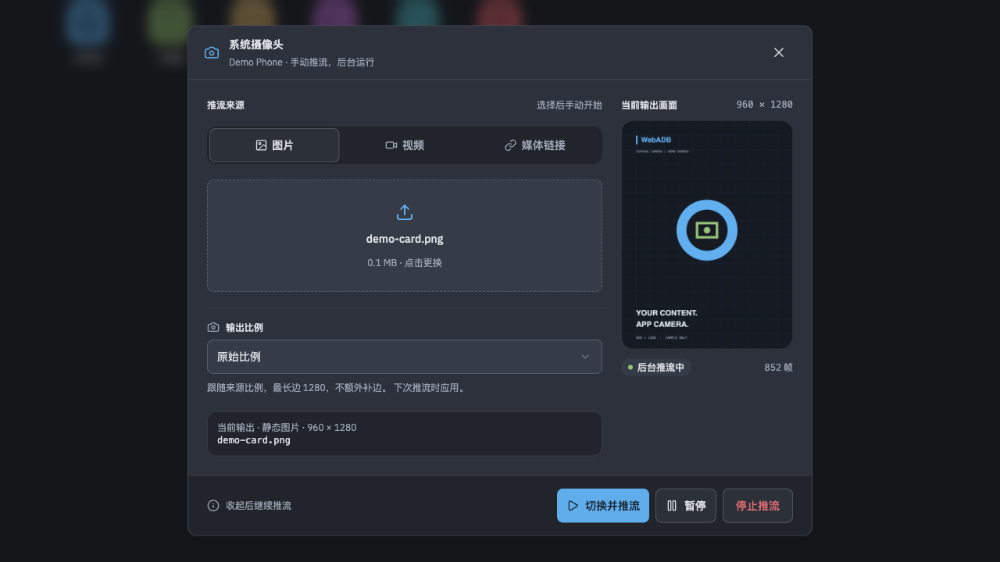
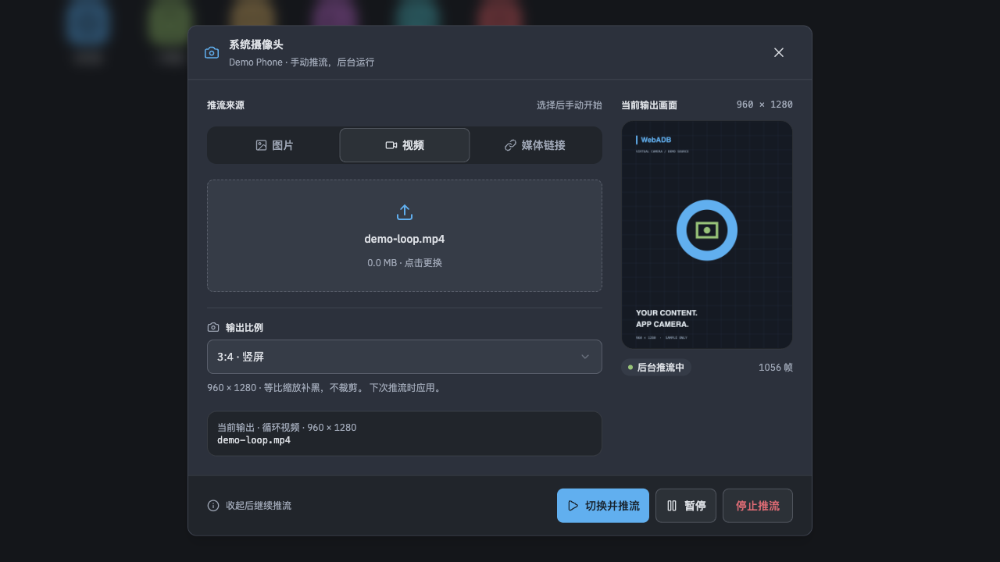
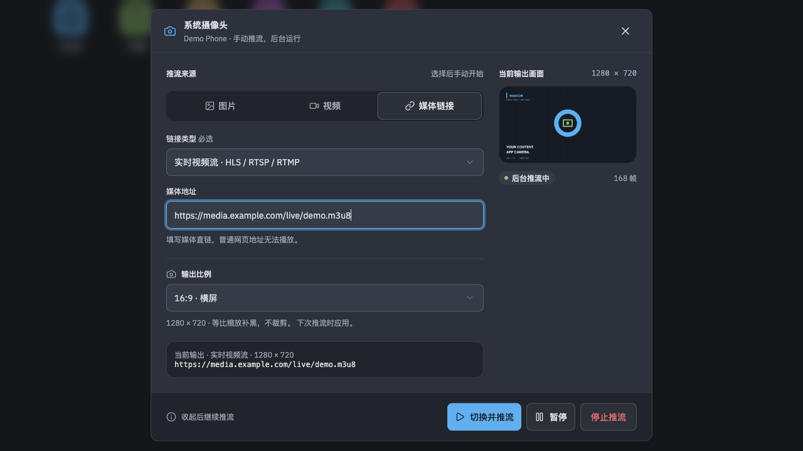
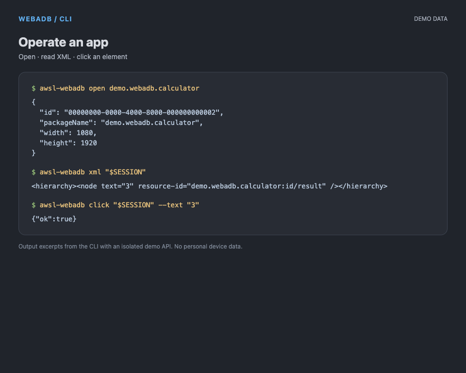
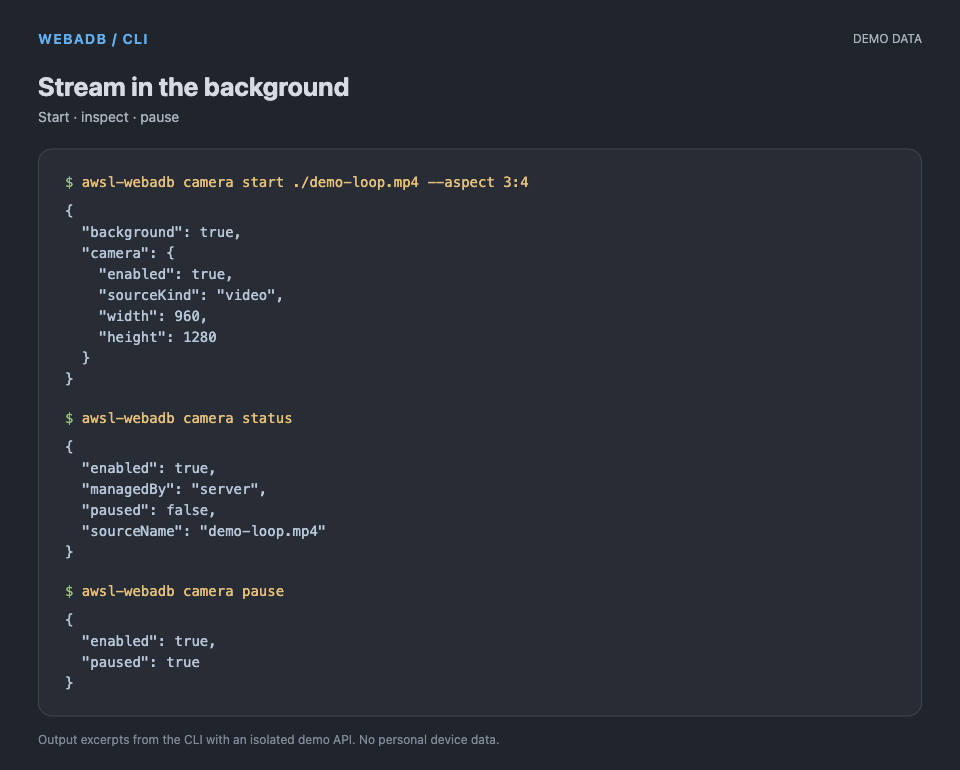

# WebADB Desk

**[English](README.en.md) · [简体中文](README.md)**

[CLI app control](#control-apps-from-the-cli) · [CLI streaming](#stream-to-the-camera-from-the-cli) · [Install](#install-and-run) · [Features](#features)

Open, inspect and control Android apps from your browser or terminal. Feed images, videos and live streams into an app's virtual camera. **One `awsl-webadb` binary contains the server, web interface and CLI client. No root required.**



*Screenshots use an isolated Demo Phone, generic apps and sample media, without personal device data. UI screenshots show the existing interface; CLI images contain actual output excerpts from a demo API. See the [verification log](docs/verification.md) for physical-device test coverage.*

## Control apps from the CLI

**No browser required.** The CLI and web interface share backend sessions: apps opened from the CLI appear on the desktop, while web actions, focus, minimize and close changes are reflected in the CLI.

```bash
awsl-webadb devices
awsl-webadb open com.android.chrome --device 1
awsl-webadb sessions

# Replace SESSION with the id returned by open
awsl-webadb screenshot SESSION --output app.jpg
awsl-webadb xml SESSION --output app.xml
awsl-webadb elements SESSION

# Select by text, resource ID, accessibility description or latest node ID
awsl-webadb click SESSION --text "OK"
awsl-webadb click SESSION --resource-id com.example:id/button
awsl-webadb click SESSION --description "Search"
awsl-webadb click SESSION --node e12
awsl-webadb text SESSION "hello" --resource-id com.example:id/input

# Screenshot coordinates work on pages without accessibility elements
awsl-webadb tap SESSION 100 200
awsl-webadb swipe SESSION 100 800 100 200 --duration 300
awsl-webadb key SESSION BACK
awsl-webadb close SESSION
```

`--device` takes the transport ID returned by `devices`; omit it when only one device is connected. Set display dimensions with `open --width 1080 --height 1920`. Opening the same app again reuses its session. Select a backend with `--url http://127.0.0.1:3000` or `WEBADB_URL`. Control commands return JSON for scripts; `xml` emits XML directly when no output file is specified.

Screenshots and input coordinates use the app's original display dimensions. XML / JSON comes from Android's accessibility tree and includes parent relationships. Read elements again after the page changes before reusing node IDs. Without a selector, `text` writes to the focused input. The web interface's page and element inspector provides the same controls.

## Stream to the camera from the CLI

Use a file or direct media URL as the virtual-camera source for **apps running in WebADB's independent app windows**.

```bash
# Images repeat continuously; local videos loop
awsl-webadb camera start ./image.png
awsl-webadb camera start ./video.mp4 --aspect original
awsl-webadb camera start ./video.mp4 --aspect 9:16

# URLs require an explicit type: image, video or stream
awsl-webadb camera start https://media.example.com/image.png --kind image
awsl-webadb camera start https://media.example.com/video.mp4 --kind video
awsl-webadb camera start rtsp://camera.example.com/live --kind stream
awsl-webadb camera start https://media.example.com/live.m3u8 --kind stream

awsl-webadb camera status
awsl-webadb camera pause
awsl-webadb camera resume
awsl-webadb camera stop
```

Replace the example domains with your own sources. Supports direct HTTP(S) images / videos and HLS, RTSP and RTMP streams. **Ordinary webpage URLs are not media sources.** Use `--device` to select among multiple devices.

`camera start` returns immediately after success. **The backend keeps streaming when the CLI, browser or app window closes.** Other clients can inspect, switch, pause, resume or stop the source; the server must stay running. Images repeat, videos loop, and pausing a live stream freezes the delivered frame; resuming reads the latest frames. Local files are streamed to temporary storage on the backend host and removed on stop or replacement. Source files are never copied to phone storage.

## Install and run

Four options: **standalone binary, Homebrew, Docker, or source**.

### 1. Standalone binary

Download the matching asset from [GitHub Releases](https://github.com/awsl-project/awsl-webadb/releases/latest) and verify it against the accompanying `SHA256SUMS`.

| System | Architecture | Asset |
| --- | --- | --- |
| Linux | x64 | `awsl-webadb-linux-amd64` |
| Linux | arm64 | `awsl-webadb-linux-arm64` |
| macOS | Intel | `awsl-webadb-macos-amd64` |
| macOS | Apple Silicon | `awsl-webadb-macos-arm64` |

For example, on macOS Apple Silicon, run from your download directory:

```bash
chmod +x awsl-webadb-macos-arm64
mv awsl-webadb-macos-arm64 awsl-webadb
# Optional: move into PATH
mkdir -p ~/.local/bin
mv awsl-webadb ~/.local/bin/
export PATH="$HOME/.local/bin:$PATH"
adb start-server
awsl-webadb serve
```

Open **http://127.0.0.1:3000**. Keep the server running and use another terminal for CLI commands. The web interface, fonts, scrcpy server and Android helper are embedded; Bun, Node.js and `node_modules` are unnecessary.

The server host needs [Android Platform Tools / ADB](https://developer.android.com/tools/releases/platform-tools). Enable USB debugging on the phone and authorize the host. Wi-Fi pairing and connections also use the server's ADB instance. Virtual-camera streaming additionally requires [FFmpeg](https://ffmpeg.org/download.html); set its executable with `--ffmpeg PATH`. On macOS, install dependencies with `brew install --cask android-platform-tools` and `brew install ffmpeg`; on Linux, install `adb` and `ffmpeg` through your distribution.

### 2. Homebrew (this repository is the Tap)

```bash
brew tap awsl-project/webadb https://github.com/awsl-project/awsl-webadb.git
brew install awsl-project/webadb/awsl-webadb
# macOS; on Linux, install adb through your distribution
brew install --cask android-platform-tools
adb start-server
awsl-webadb serve
# Or let Homebrew run the service in the background:
# brew services start awsl-project/webadb/awsl-webadb
```

The Formula downloads the release binary for your OS and architecture and installs FFmpeg; install ADB separately. Upgrade with `brew update` and `brew upgrade awsl-project/webadb/awsl-webadb`. The source repository doubles as the Tap, so no cross-repository token is needed. Releases automatically update `Formula/awsl-webadb.rb`. [Homebrew supports an explicit Git URL for a Tap](https://docs.brew.sh/Taps.html).

### 3. Docker

```bash
docker run --rm \
  -p 127.0.0.1:3000:3000 \
  -p 127.0.0.1:5037:5037 \
  -v awsl-webadb-data:/var/lib/awsl-webadb \
  ghcr.io/awsl-project/awsl-webadb:latest
```

The image supports Linux amd64 / arm64, includes ADB and FFmpeg, and connects to Wi-Fi devices. **USB passthrough is unsupported.** Open http://127.0.0.1:3000. The volume persists ADB authorization, pairing, favorites and cache. Use the CLI on your host or run `docker exec CONTAINER /app/awsl-webadb devices`.

### 4. Run from source

Requires Bun 1.4.3 or later and ADB; camera streaming requires FFmpeg.

```bash
git clone https://github.com/awsl-project/awsl-webadb.git
cd awsl-webadb
bun install
adb start-server
bun run dev
```

The development UI runs at http://127.0.0.1:5173 and the backend at http://127.0.0.1:3000. Use `bun run cli …` for CLI commands. See the [development guide](docs/development.md) for production and standalone builds and configuration.


## Features

| Capability | Details |
| --- | --- |
| Web desktop | Multiple windows on desktop, touch and full-screen apps on mobile; One Half light / dark themes, system theme, PWA installation and update prompts |
| Connections | USB / Wi-Fi, debugging authorization state, wireless pairing and connection, device switching; all through the backend ADB server |
| Status and control | Device details, battery and charging status; navigation, volume, media, power / wake / sleep, notifications, quick settings and device PNG screenshots; control is available by default without a read-only mode switch |
| App windows | Favorites and app catalog, independent displays, orientation and resolution changes, touch / drag / wheel / keyboard input |
| Page inspection | Per-app JPEG screenshots, XML / JSON accessibility elements, element selection and clicks, coordinate input; shared web / CLI sessions |
| Screen mirroring | scrcpy 4.1; independent apps and screen mirroring use their respective displays |
| File management | Directory navigation, search, sorting, upload / download progress and overwrite confirmation; streaming downloads in supported browsers |
| Virtual camera | Images, looping videos and media URLs; explicit URL types, background streaming and state shared across clients |
| Aspect ratios | Original, 3:4, 4:3, 9:16, 16:9 and 1:1; preview and Android virtual camera share output dimensions |
| Audio | Manually play phone audio output; **microphone streaming is not implemented and the computer microphone is not captured** |
| Server storage | App names and icons cached for 7 days; per-device favorites persist without expiration |
| Deployment | One binary as server or client; two architectures each for Linux / macOS, plus a dual-architecture container |

## More screenshots

<details>
<summary>Show mobile, virtual-camera and CLI screenshots</summary>

<table>
<tr><th>Mobile home</th><th>Image → virtual camera</th></tr>
<tr><td align="center"></td><td></td></tr>
<tr><th>Looping video → virtual camera</th><th>Media URL → virtual camera</th></tr>
<tr><td></td><td></td></tr>
<tr><th>CLI app control</th><th>CLI background streaming</th></tr>
<tr><td></td><td></td></tr>
</table>

</details>

## Camera compatibility and lifecycle

Virtual-camera input requires the **Android 16 VirtualCamera API**. Independent windows require a ROM implementing VirtualDevice and related interfaces with access for ADB shell. **No root is used, and the phone's main-screen camera is not globally replaced.** Apps inside WebADB's virtual device share front and rear virtual cameras using the same source. The phone's main screen can remain off. Apps may impose their own multi-display, screenshot or audio-capture restrictions.

Opening an app or selecting a file does not start camera streaming: start it manually. System camera privacy switches, ROM privacy modes and app permissions remain in effect; the service does not change them automatically. Streaming has no audio track.

| Aspect ratio | Output dimensions |
| --- | --- |
| `original` (default) | Preserves source ratio, longest edge at most 1280, no upscaling of small images; even dimensions with at most one-pixel rounding |
| `3:4` | 960 × 1280 |
| `4:3` | 1280 × 960 |
| `9:16` | 720 × 1280 |
| `16:9` | 1280 × 720 |
| `1:1` | 1280 × 1280 |

Fixed ratios fit the source proportionally with centered black padding, without cropping or stretching. `--aspect` or the web ratio selection applies on the next start / switch. Dimension changes recreate the virtual camera and app displays; apps may need to reopen the camera. Restart streaming if a live source changes dimensions.

Closing the browser does not end backend app sessions. Sessions expire after 15 minutes without reads or actions; closing a window or using `close` releases them immediately. Camera streaming runs independently and releases its resources on stop, device disconnection or server exit. Server exit also cleans up displays, temporary JARs, companion associations and port forwarding created by the service.

## Configuration and documentation

The server listens locally by default. `serve` accepts `--host`, `--port`, `--adb-host`, `--adb-port`, `--ffmpeg`, `--static-dir` and `--data-dir`, plus corresponding environment variables. The default data directory is `~/.local/share/awsl-webadb`: `metadata/` is disposable cache; `favorites/` stores permanent favorites.

For trusted LAN access, explicitly set `--host 0.0.0.0`. For remote access, use an authenticated HTTPS proxy and configure allowed full origins through `ALLOWED_ORIGINS`. The PWA's offline shell only serves the interface; device operations need the backend online.

- [Development, builds, configuration and Homebrew integration](docs/development.md) (Chinese)
- [Physical-device and media verification log](docs/verification.md) (Chinese)
- [Third-party notices](THIRD_PARTY_NOTICES.md)
- `awsl-webadb --help` / `awsl-webadb --version`
